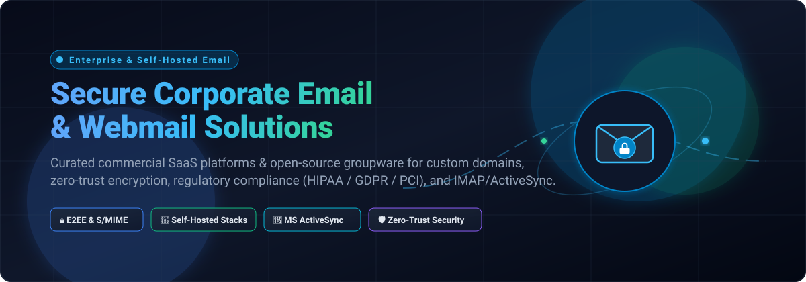

# Awesome Secure Corporate Email & Webmail

  

  

    <strong>A curated directory of top-tier Secure Corporate Email, Business Webmail, and Groupware Solutions.</strong> 
    Covering Enterprise SaaS suites and modern Open-Source self-hosted mail servers with custom domain routing, End-to-End Encryption (E2EE), post-quantum cryptography, and regulatory compliance (HIPAA, GDPR, PCI-DSS, SOC 2).
  

  

    
    
    
    
  

---

## 📋 Table of Contents

- [Sector Overview & Market Dynamics](#-sector-overview--market-dynamics)
- [SaaS / Hosted Platforms](#-saas--hosted-platforms)
- [Open-Source Software](#-open-source-software)
- [Feature Comparison Matrix](#-feature-comparison-matrix)
- [Selection & Architecture Guide](#-selection--architecture-guide)
- [Contributing](#-contributing)
- [License](#-license)

---

## 🌐 Sector Overview & Market Dynamics

The global enterprise email, corporate webmail, and secure communication market is estimated at **$28.5 billion to $33 billion in 2026** (projected to exceed $55 billion by 2032 at a ~9.2% CAGR), driven by zero-trust architecture mandates, regulatory compliance (GDPR, HIPAA, NIS2, SOC 2), and escalating sophisticated BEC (business email compromise) threats. 

Market dynamics exhibit an **extreme concentration at the top with a highly fragmented privacy and self-hosted long tail**: Microsoft 365 (Exchange Online) and Google Workspace operate as a near-duopoly commanding >85% of total enterprise seats ("winner-take-most" bundled productivity suites), while privacy-first zero-access providers (Proton, Tuta, Mailbox.org) and open-source self-hosted mail infrastructures (docker-mailserver, Stalwart, Mailcow) capture specialized niches demanding rigorous data sovereignty, zero-knowledge encryption, and exemption from proprietary telemetry.

---

## 🟦 SaaS / Hosted Platforms

Commercial, cloud-hosted corporate email and webmail suites sorted in descending order of company size (valuation / annual revenue).

| Provider | Company Scale (Valuation / Revenue) | Starting Pricing (Paid) | Free Tier Limits / Free Trial | Key Security & Cryptography | Primary Use Case |
| :--- | :--- | :--- | :--- | :--- | :--- |
| **[Microsoft 365 (Exchange Online)](https://www.microsoft.com/microsoft-365/exchange/exchange-online)** | **$3.1 Trillion market cap** (~$245B annual revenue) | **$6.00/user/month** (Exchange Online Plan 1, annual commitment) | **30-day free trial** (up to 25 user seats, 50 GB mailbox storage per user, full Purview compliance trial) | Defender for O365 sandboxing, Safe Links, OME, S/MIME, Azure RMS, Entra ID Conditional Access | Enterprises requiring deep compliance, DLP, and native Outlook ecosystem |
| **[Google Workspace](https://workspace.google.com/)** | **$2.2 Trillion market cap** (Alphabet; ~$350B annual revenue) | **$6.00/user/month** (Business Starter, annual commitment; or $7.20/user/month flexible) | **14-day free trial** (up to 10 user seats, 30 GB pooled storage per user, full Google Workspace apps) | Zero-trust context-aware access, Google Safe Browsing, S/MIME (Enterprise tiers), Vault eDiscovery | Modern businesses prioritizing real-time collaboration and cloud-native workflows |
| **[Zoho Mail](https://www.zoho.com/mail/)** | **~$1.4 Billion annual revenue** (Privately held, estimated valuation $10B–$15B) | **$1.00/user/month** (Mail Lite, 5 GB storage; billed annually) | **Free Forever Plan** (up to 5 users, 5 GB storage/user, 25 MB attachment limit, webmail/mobile app access; excludes IMAP/POP) | S/MIME, TLS encryption, integrated eDiscovery, retention policies, SPF/DKIM/DMARC wizards | Startups and budget-conscious teams wanting custom domain business email |
| **[Proton Mail Business](https://proton.me/business/mail)** | **~$100 Million ARR** (Privately held / Foundation backed; estimated valuation $1.5B–$2B) | **$6.99/user/month** (Mail Professional, billed annually; or $7.99/user/month billed monthly) | **Free Personal Plan** (1 user, 500 MB to 1 GB storage, 150 messages/day, no custom domains) or **14-day business trial** on request | End-to-end zero-access encryption (PGP based), zero-access storage, Swiss jurisdiction, HIPAA/GDPR BAA | Regulated industries (legal, healthcare, finance) demanding zero-access privacy |
| **[Tuta Business](https://tuta.com/business)** | **~$10M–$20M ARR** (Privately held; estimated valuation $50M–$100M) | **€3.00/user/month** (~$3.25/user/month, Essential tier billed annually) | **Free Personal Plan** (1 user, 1 GB storage, Tuta domain only) or **14-day money-back guarantee / business evaluation** | Post-quantum hybrid encryption (TutaCrypt: Kyber + x25519 + AES-256), encrypted subject lines & search index, German jurisdiction | Zero-metadata privacy teams needing post-quantum cryptographic protection |
| **[Mailbox.org](https://mailbox.org/en/business)** | **~$5M–$10M ARR** (Privately held / Heinlein Support; estimated valuation $20M–$40M) | **€1.00/user/month** (~$1.08/user/month, Light tier; or €3.00/user/month Standard with custom domain) | **30-day free trial** (Full feature access, test credit included, no payment details required upfront) | Integrated PGP encryption, DANE/DNSSEC, German servers, 100% green energy data centers | Teams wanting European data privacy with native IMAP/POP3 desktop client compatibility |

---

## 🟩 Open-Source Software

Self-hosted, community-driven corporate email and webmail systems, groupware servers, and containerized mail stacks. Sorted in descending order of GitHub stargazers:

| Software & Star Badge | Stack / Language | License | Custom Domains | Built-in Webmail | Architecture Highlights |
| :--- | :--- | :--- | :---: | :---: | :--- |
| **[docker-mailserver](https://github.com/docker-mailserver/docker-mailserver)**  | Docker / Postfix / Dovecot | MIT | ✅ | Optional (integrates Roundcube/SnappyMail) | Battle-tested, full-featured containerized mail server. Features automated configuration, SpamAssassin/Rspamd, ClamAV, OpenDKIM, and Fail2ban out of the box. |
| **[Stalwart](https://github.com/stalwartlabs/stalwart)**  | Rust | AGPL-3.0 | ✅ | Optional (Web Admin & WebDAV) | All-in-one scalable mail and collaboration server written in memory-safe Rust. Native support for JMAP, IMAP4, SMTP, CalDAV, CardDAV, and Sieve. |
| **[mailcow: dockerized](https://github.com/mailcow/mailcow-dockerized)**  | Docker / PHP / Python | GPL-3.0 | ✅ | ✅ (SOGo integrated) | Comprehensive modern mail suite orchestrated with Docker Compose. Integrates SOGo groupware, Rspamd, ACME/Let's Encrypt automation, 2FA/FIDO2, and REST API. |
| **[Mailu](https://github.com/Mailu/Mailu)**  | Docker / Python | MIT | ✅ | ✅ (Roundcube or SnappyMail) | Modular, containerized mail distribution for Docker and Kubernetes. Simple setup wizard, admin web UI, anti-spam (Rspamd), antivirus, and relaying. |
| **[Roundcube Webmail](https://github.com/roundcube/roundcubemail)**  | PHP / JavaScript | GPL-3.0+ | ✅ | ✅ (Primary Webmail) | Industry-standard browser-based multilingual IMAP client. Features skinnable desktop-like UI, drag-and-drop, full address book with CardDAV, and PGP encryption plugins. |
| **[Mailflare](https://github.com/hieunc229/mailflare)**  | Node.js / SQLite | AGPL-3.0 | ✅ | ✅ (Modern Next.js) | Lightweight Google Workspace alternative with custom domains, shared inboxes, calendar bookings, AI assistant, and MCP endpoint; routes via Cloudflare/SES/Resend. |
| **[mox](https://github.com/mjl-/mox)**  | Go | MIT / Open Source | ✅ | ✅ (Built-in Webmail & Admin) | Single-binary modern mail server in Go. Automatic TLS via Let's Encrypt, ACME, SPF, DKIM, DMARC, MTA-STS, reputation tracking, and fast full-text search. |
| **[Modoboa](https://github.com/modoboa/modoboa)**  | Python / Django | ISC | ✅ | ✅ (Integrated Webmail) | Modular mail hosting and management platform with intuitive administration panel, calendar, contacts, per-domain limits, autoreply, and DMARC statistics reporting. |
| **[SOGo](https://github.com/Alinto/sogo)**  | Objective-C | GPL/LGPL v2+ | ✅ | ✅ (Rich AJAX Webmail) | Enterprise groupware server with native Microsoft ActiveSync (EAS), CalDAV, and CardDAV. Seamlessly syncs email, calendars, and contacts across Android, iOS, and Outlook. |
| **[iRedMail](https://github.com/iredmail/iRedMail)**  | Shell / Python / OpenBSD | GPL-2.0 | ✅ | ✅ (Roundcube integrated) | Zero-cost script installer creating an enterprise-grade mail server on Linux/BSD using Postfix, Dovecot, Nginx, and OpenLDAP or MariaDB/PostgreSQL backends. |
| **[SnappyMail](https://github.com/the-djmaze/snappymail)**  | PHP / JavaScript | AGPL-3.0 | ✅ | ✅ (Ultra-fast Webmail) | Modern, blazing-fast, lightweight webmail client (forked from RainLoop) optimized for speed, minimal RAM consumption, OpenPGP, S/MIME, and 2FA authentication. |
| **[chasquid](https://github.com/albertito/chasquid)**  | Go | Apache-2.0 | ✅ | ❌ (SMTP MTA engine) | Zero-headache SMTP server written in Go with automated Let's Encrypt TLS certificates, Dovecot authentication integration, and strict security hygiene. |
| **[grommunio](https://github.com/grommunio/grommunio-web)**  | C / PHP | AGPL-3.0 | ✅ | ✅ (Exchange-like Webmail) | Drop-in open-source Microsoft Exchange replacement supporting native MAPI/RPC, EAS ActiveSync, S/MIME, OpenPGP, video meetings, and chat collaboration. |

---

## 📊 Feature Comparison Matrix

| Solution | Deployment | License | Custom Domains | Encryption At-Rest / In-Transit | IMAP / POP3 / SMTP | ActiveSync / CalDAV / CardDAV |
| :--- | :--- | :--- | :---: | :---: | :---: | :---: |
| **Microsoft 365** | Cloud SaaS | Commercial | ✅ | BitLocker, TLS, S/MIME, OME | ✅ | Native Exchange / ActiveSync |
| **Google Workspace** | Cloud SaaS | Commercial | ✅ | AES-256, TLS, S/MIME (Ent+) | ✅ | CalDAV, CardDAV, Gmail API |
| **Zoho Mail** | Cloud SaaS | Commercial | ✅ | AES-256, S/MIME (Premium) | Paid tiers | CalDAV, CardDAV, ActiveSync |
| **Proton Mail** | Cloud SaaS | Commercial | ✅ | End-to-End Zero-Access, PGP | Bridge app | Proprietary Proton Bridge |
| **Tuta Business** | Cloud SaaS | Commercial | ✅ | TutaCrypt (Post-Quantum Hybrid) | ❌ (Native apps only) | Proprietary synced apps |
| **Mailbox.org** | Cloud SaaS | Commercial | ✅ | PGP, DANE, SSL/TLS | ✅ | CalDAV, CardDAV, ActiveSync |
| **docker-mailserver** | Self-Hosted | MIT | ✅ | TLS 1.3, DKIM, Postfix/Dovecot | ✅ | Integrable |
| **Stalwart** | Self-Hosted | AGPL-3.0 | ✅ | TLS 1.3, ACME, JMAP, Sieve | ✅ | CalDAV, CardDAV, WebDAV |
| **mailcow** | Self-Hosted | GPL-3.0 | ✅ | TLS, Rspamd, S/MIME via UI | ✅ | SOGo ActiveSync, CalDAV |
| **Mailu** | Self-Hosted | MIT | ✅ | TLS, Rspamd, ClamAV | ✅ | Integrable |
| **Roundcube** | Self-Hosted | GPL-3.0+ | ✅ | Client-side PGP / SSL/TLS | IMAP web frontend | CardDAV plugin |
| **Mailflare** | Self-Hosted | AGPL-3.0 | ✅ | External Provider (SES/Resend) | Via Provider API | CalDAV booking system |
| **mox** | Self-Hosted | Open Source | ✅ | Auto Let's Encrypt TLS, DMARC | ✅ | IMAP4rev1, SMTP |
| **Modoboa** | Self-Hosted | ISC | ✅ | TLS, Postfix/Dovecot integration | ✅ | CalDAV, CardDAV |
| **SOGo** | Self-Hosted | GPL/LGPL | ✅ | TLS via reverse proxy | Client interface | Native ActiveSync, CalDAV |
| **iRedMail** | Self-Hosted | GPL-2.0 | ✅ | SSL/TLS, OpenDKIM, Amavis | ✅ | SOGo / CalDAV optional |
| **SnappyMail** | Self-Hosted | AGPL-3.0 | ✅ | OpenPGP, S/MIME, TLS | IMAP web frontend | CalDAV address book |
| **chasquid** | Self-Hosted | Apache-2.0 | ✅ | Auto Let's Encrypt TLS, SPF | SMTP engine only | N/A (MTA) |
| **grommunio** | Self-Hosted | AGPL-3.0 | ✅ | S/MIME, OpenPGP browser keys | ✅ | Native ActiveSync & MAPI |

---

## 🎯 Selection & Architecture Guide

Choosing between SaaS corporate email and self-hosted open-source groupware depends on your operational capacity and regulatory obligations:

1. **Enterprise Productivity & Compliance:**
   - Choose **Microsoft 365** if your organization requires automated eDiscovery, legal hold, Purview DLP, and tight Windows/Outlook Active Directory integration.
   - Choose **Google Workspace** for agile startups needing seamless Google Docs/Meet synergy and straightforward administration.

2. **Zero-Trust Privacy & Anti-Surveillance:**
   - Choose **Proton Mail Business** for Swiss-jurisdiction zero-access encryption while retaining desktop clients via Proton Bridge.
   - Choose **Tuta Business** for maximum resistance against quantum computing decryption (TutaCrypt) and encrypted metadata.

3. **Self-Hosted Complete Suites:**
   - Choose **mailcow: dockerized** or **grommunio** for an out-of-the-box Exchange replacement with ActiveSync mobile synchronization and a webmail UI.
   - Choose **docker-mailserver** for a robust headless mail infrastructure configured via clean environment variables and files.
   - Choose **Stalwart** for a state-of-the-art Rust implementation supporting JMAP and modern web standards.

---

## 🤝 Contributing

Contributions, fixes, and recommendations are welcome! Please follow these criteria:
- Open-source tools must be actively maintained (commit/release within the last 12 months) and have a clean permissive or copyleft license.
- To suggest additions, submit a Pull Request specifying:
  - Repository link and official website
  - Primary language stack and architecture model
  - Distinguishing features (security, protocol support, encryption)

---

## 📄 License

This repository and curated list are licensed under [CC0 1.0 Universal](LICENSE) (Public Domain Dedication). All linked software projects and trademarks remain property of their respective owners.

  Maintained with ❤️ for secure corporate communications and digital sovereignty.

